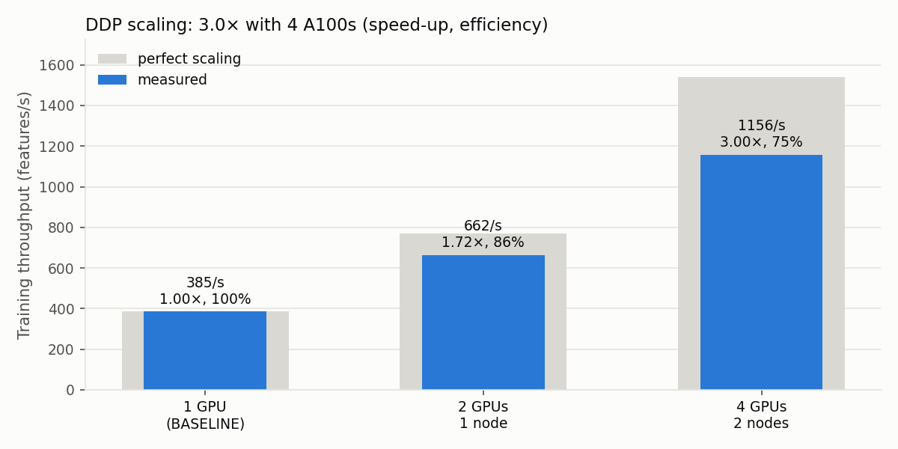

# BERT-SQuAD Training DISTRIBUTED
Distributed version of the [BASELINE](../BASELINE/README.md): the same fine-tuning of `google-bert/bert-base-uncased` on SQuAD v1.1, parallelized with **PyTorch DistributedDataParallel (DDP)** and measured on FinisTerrae III on **1 node × 2 A100** and **2 nodes × 2 A100** (4 GPUs).

| Full SQuAD, 2 epochs, AMP + batch 32/GPU + compile | GPUs | Throughput | Speed-up | Efficiency | Training time | F1 |
|---|---|---|---|---|---|---|
| BASELINE (best single-GPU run) | 1 | 385 features/s | 1.00× | 100% | 490 s | 87.6 |
| DDP, 1 node | 2 | 662 features/s | **1.72×** | 86% | 332 s | 87.3 |
| DDP, 2 nodes | 4 | 1,156 features/s | **3.00×** | 75% | 199 s | 87.0 |

Compared with the original FP32 single-GPU baseline (2,939 s), training on 4 GPUs is **14.8× faster**, with F1 within 0.7 points (87.0 vs 87.7).



---

## 1. Repository contents (`DISTRIBUTED/`)

| File or folder | Purpose |
|---|---|
| `bert_lab.py` | The BASELINE training script, made distributed with DDP (see section 3) |
| `ddp-1n.sh` | SLURM job script: 1 node, 2 A100, launched with `torchrun --standalone` |
| `ddp-2n.sh` | SLURM job script: 2 nodes, 2 A100 each, one `torchrun` per node started by `srun` |
| `env_setup.sh`, `requirements.txt` | Same environment as BASELINE (DDP and NCCL ship with `torch`, nothing new to install) |
| `plot_results.py` | Builds the figures in `figures/` from the TensorBoard logs (reads the BASELINE run from `../BASELINE/runs/`) |
| `logs/` | SLURM output of every run reported below |
| `runs/` | TensorBoard logs, and the profiler traces `runs/prof-*/trace.json` (open them in ui.perfetto.dev) |
| `figures/` | Figures used in this README |

---

## 2. Jobs submitted

From `DISTRIBUTED/` (`--batch-size` is per GPU):

```bash
# training runs                                            -> logs/ddp-1n-11036376.out, logs/ddp-2n-11036377.out
sbatch --time=00:45:00 ddp-1n.sh --precision amp --batch-size 32 --lr 3e-5 --compile
sbatch --time=00:45:00 ddp-2n.sh --precision amp --batch-size 32 --lr 3e-5 --compile

# profiles                                                 -> logs/ddp-1n-11036586.out, logs/ddp-2n-11036587.out
sbatch --time=00:15:00 ddp-1n.sh --precision amp --batch-size 32 --lr 3e-5 --compile --profile --log-dir runs/prof-1n
sbatch --time=00:15:00 ddp-2n.sh --precision amp --batch-size 32 --lr 3e-5 --compile --profile --log-dir runs/prof-2n
```

---

## 3. What changed compared with BASELINE

- **Strategy:** plain DDP. Every GPU holds a full copy of the model, trains on a different part of the data, and gradients are averaged with an NCCL all-reduce after each backward pass.
- **Setup:** `init_process_group("nccl")`, one process per GPU, GPU chosen with `LOCAL_RANK`.
- **Data:** rank 0 tokenizes SQuAD first while the others wait at a barrier (avoids a `SIGBUS` crash from 4 processes writing the same cache file); `DistributedSampler` with `set_epoch` splits the data.
- **Model:** wrapped with DDP, then `torch.compile`d; optimizer and checkpoint use the unwrapped model.
- **Rank 0 only:** evaluation (uncompiled model), TensorBoard, checkpoint, printing.
- **Metrics across GPUs:** loss averaged, throughput summed, epoch time and peak memory taken as the maximum.

---

## 4. Results

### 4.1 Training runs (full SQuAD, 2 epochs, `--precision amp --batch-size 32 --lr 3e-5 --compile`)

| | **1 GPU (BASELINE)** | **DDP, 1 node × 2 GPUs** | **DDP, 2 nodes × 2 GPUs** |
|---|---|---|---|
| Global batch / optimizer steps per epoch | 32 / 2,765 | 64 / 1,382 | 128 / 691 |
| Throughput after warm-up (epoch 0 / 1) | 385.8 / 383.9 features/s | 660.4 / 664.2 | 1,157.8 / 1,154.3 |
| **Throughput speed-up** | 1.00× | **1.72×** | **3.00×** |
| **Scaling efficiency** (speed-up / GPUs) | 100% | 86% | 75% |
| Epoch training times (epoch 0 / 1) | 259.7 / 230.5 s | 180.8 / 151.4 s | 118.1 / 80.9 s |
| **Total training time** | 490.2 s (8.2 min) | 332.3 s (5.5 min) | **199.0 s (3.3 min)** |
| Training-time speed-up | 1.00× | 1.48× | 2.46× |
| Speed-up vs FP32 baseline (2,939.1 s) | 6.00× | 8.85× | **14.77×** |
| Peak GPU memory | 5.57 GB | 6.09 GB | 6.09 GB |
| EM / F1 after epoch 0 | 78.5 / 86.6 | 77.6 / 86.0 | 76.7 / 85.1 |
| **Final EM / F1** | 80.2 / **87.6** | 79.4 / **87.3** | 79.4 / **87.0** |
| Total evaluation time (rank 0) | 50.9 s | 32.3 s | 31.2 s |

GPUs: NVIDIA A100-PCIE-40GB. 1-node run on `c208-5`; 2-node run on `c208-5` and `c209-2`.

- **Throughput is the main speed-up measure:** it is measured after a 50-step warm-up, while the total training time also includes fixed costs (see 4.3).
- **Accuracy:** F1 drops by 0.35 (2 GPUs) and 0.62 points (4 GPUs). The per-GPU batch and learning rate were kept from BASELINE, so the global batch is 2× / 4× larger with 2× / 4× fewer optimizer steps.
- **Memory:** +0.5 GB per GPU, about the size of the gradients (0.44 GB in FP32), which DDP keeps in buckets for the all-reduce.
- **Evaluation times are not comparable** with BASELINE, which evaluated with the compiled model (first evaluation included compilation).

### 4.2 Profiling: why 86% and 75%, not 100%

`torch.profiler` on all ranks, 5 recorded steps, values per step for rank 0.

| Per training step | 1 GPU (BASELINE) | 1 node × 2 GPUs | 2 nodes × 2 GPUs |
|---|---|---|---|
| Real step time, from throughput (32 features per GPU) | 83.1 ms | 96.6 ms | 110.7 ms |
| Extra time compared with 1 GPU | — | +13.5 ms | +27.6 ms |
| NCCL all-reduce GPU time (`ncclDevKernel_AllReduce_Sum_f32_RING_LL`) | — | 58.3 ms | 72.2 ms |
| All-reduce calls per step | — | 14 | 14 |
| Matrix multiplications (`aten::mm`) | — | 24.0 ms | 26.8 ms |
| Profiled step time (`ProfilerStep*`) | — | 106.3 ms | 121.5 ms |

- Compute per GPU is unchanged (batch 32 per GPU); the extra 13.5 / 27.6 ms per step from DDP gives exactly 86% / 75% efficiency.
- Most of the all-reduce is hidden: DDP sends each gradient bucket while the backward pass is still running, so 58 ms of communication adds only 13.5 ms.
- On 2 nodes the gradients also cross the network between nodes: the all-reduce grows to 72 ms and less of it is hidden.

### 4.3 Training time vs throughput

The DDP epochs are longer than their throughput predicts (on 1 GPU they match exactly): epoch 0 includes `torch.compile` and NCCL setup (≈ 40–47 s, a fixed cost), and epoch 1 includes the other GPUs waiting while rank 0 saves the checkpoint (18 s on 1 node, 4 s on 2 nodes). These costs don't shrink with more GPUs, so the training-time speed-up is lower than the throughput speed-up.
